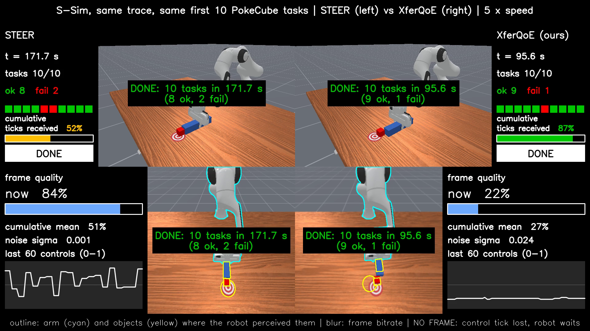
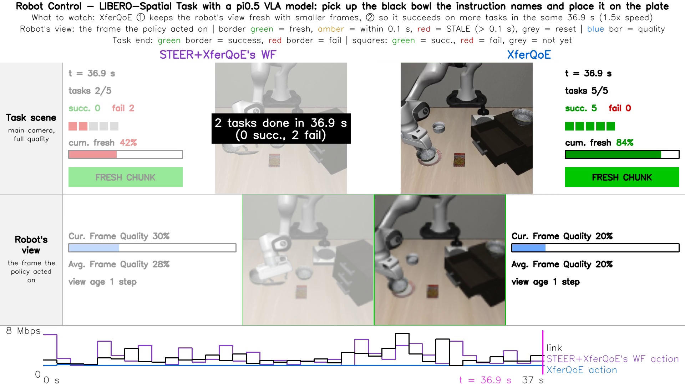
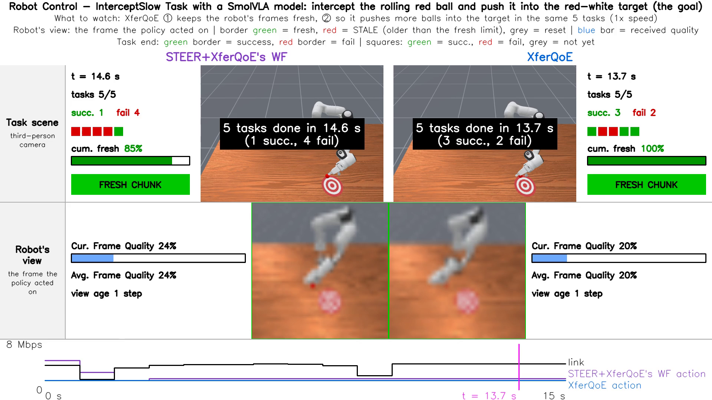

# Demo videos

Short demo videos: a robot controlled over a wireless link by two rate controllers, robot foundation models served over a wireless link, sixteen cameras sharing one wireless link, and a robot policy under network delay. Each picture opens a page that plays the video in the browser.

## 1. STEER vs. XferQoE on the same bandwidth trace (S-Sim)

[Play in the browser](https://sonny0714.github.io/demo_video_robot/xferqoe-vs-steer.html) · [video file](videos/xferqoe_vs_steer_ssim.mp4)

The edge server runs the robot policy and the rate controller, and only observations cross the wireless link. Both sides replay the same bandwidth trace in S-Sim, a packet-level network simulator, and run the same first 10 PokeCube tasks (ManiSkill3) with the same frozen robot policy; only the rate controller differs. 5× speed, 39 s. This is one example run out of 15, not the median one; over all 15 runs and all 40 tasks, XferQoE's task QoE is higher in 14.

- Left, STEER (a learning-based rate controller): mean frame quality 50.6%, a complete observation on 51.6% of the control ticks, 10 tasks finished in 171.7 s (8 succeeded, 2 failed).
- Right, XferQoE: mean frame quality 27.2%, a complete observation on 86.8% of the control ticks, 10 tasks finished in 95.6 s (9 succeeded, 1 failed).
- The end card gives the task QoE over the 10 tasks: 0.468 (STEER) vs. 0.767 (XferQoE).

## 2. Moving-ball task under network delay: 0 ms vs. 0–1000 ms

[Play in the browser](https://sonny0714.github.io/demo_video_robot/moving-ball-delay.html) · [video file](videos/moving_ball_delay_0ms_vs_0-1000ms.mp4)

A fine-tuned SmolVLA policy intercepts a moving ball (MIKASA-Robo InterceptSlow, simulation). Both sides see the same 10 ball launches. 0.75× speed, 52 s.

- Left: no delay.
- Right: every action-chunk request draws a uniform random delay of 0–1000 ms (the first chunk arrives immediately on both sides), and the robot waits for the new chunk before it moves (synchronous execution).

In this clip the left side succeeds on 5 of the 10 launches and the right side on none. Over all 200 evaluation episodes the success rates are 55.5% and 3.0%.

## 3. Rate control for robot manipulation: STEER+XferQoE's WF vs. XferQoE

[Play in the browser](https://sonny0714.github.io/demo_video_robot/xferqoe-pokecube.html) · [video file](videos/xferqoe_pokecube.mp4)

The edge server runs the robot policy (a frozen ManiSkill3 PokeCube policy) and the rate controller, and only the robot's observations cross the wireless link. Both runs replay the same bandwidth trace with the same policy and tasks, so only the rate controller differs. STEER+XferQoE's WF (STEER with XferQoE's objective-weight fit) plays first, then XferQoE over the same 41.7 s span. 5× speed, 31 s.

- STEER+XferQoE's WF: 2 tasks finished, a complete observation on 38.9% of the control ticks, mean frame quality 34.4%.
- XferQoE: 5 tasks finished, a complete observation on 88.1% of the control ticks, mean frame quality 30.7%.

## 4. Robot foundation model, time-invariant task: LIBERO-Spatial with π0.5

[Play in the browser](https://sonny0714.github.io/demo_video_robot/xferqoe-rfm-libero.html) · [video file](videos/xferqoe_rfm_libero_spatial.mp4)

The robot policy is a robot foundation model (π0.5, public checkpoint fine-tuned on the four LIBERO suites) on the edge server; it computes each action chunk from the newest camera frame that arrives within its deadline, and the rate controller decides how the camera frames cross the wireless link. Both runs play the first five tasks on the same bandwidth trace with the same model and scene, one after the other, so only the rate controller differs. 1.5× speed, 63 s.

- By 36.9 s, when XferQoE has completed all five tasks, STEER+XferQoE's WF has finished two, with no success.
- Fresh action chunks (frame at most one 50 ms step old): 42.2% for STEER+XferQoE's WF, 84.4% for XferQoE; mean frame quality 27.9% and 20.1%.

## 5. Robot foundation model, time-varying task: MIKASA Intercept with SmolVLA

[Play in the browser](https://sonny0714.github.io/demo_video_robot/xferqoe-rfm-mikasa.html) · [video file](videos/xferqoe_rfm_mikasa_intercept.mp4)

The robot policy is SmolVLA, fine-tuned on 250 MIKASA-Robo-VLA Intercept demonstrations, on the edge server; it deflects a rolling ball to the target from the newest camera frame that arrives within its deadline, and the rate controller decides how the camera frames cross the wireless link. Both runs play their first five tasks on the same bandwidth trace with the same model and scene, one after the other, so only the rate controller differs. 1× speed, 45 s.

- XferQoE succeeds in three of the five tasks, STEER+XferQoE's WF in one.
- Fresh action chunks: 85.3% for STEER+XferQoE's WF, 100% for XferQoE; mean frame quality 23.7% and 20.0%.

## 6. Networked monitoring: sixteen cameras on one wireless link

[Play in the browser](https://sonny0714.github.io/demo_video_robot/xferqoe-monitoring.html) · [video file](videos/xferqoe_monitoring.mp4)

Sixteen cameras share one wireless link to a server whose recognition model detects objects in their frames, and every interval is scored by detection F1 against the current ground truth. The video shows the ground truth, STEER+XferQoE's WF, and XferQoE on the same bandwidth trace from 145 to 185 s at 1× speed; the per-camera link opens at 167 s.

- At 148.5 s each camera's link is 3.3 Mbps: STEER+XferQoE's WF sends 6.7 Mbps, so camera 7 holds a frame three frames old and finds none of its five objects, while XferQoE sends 2.1 Mbps and finds four.
- Over the slow span (145–166 s) XferQoE's F1 is 0.286 against 0.235; after the link opens at 167 s, STEER+XferQoE's WF scores 0.769 against 0.721.
