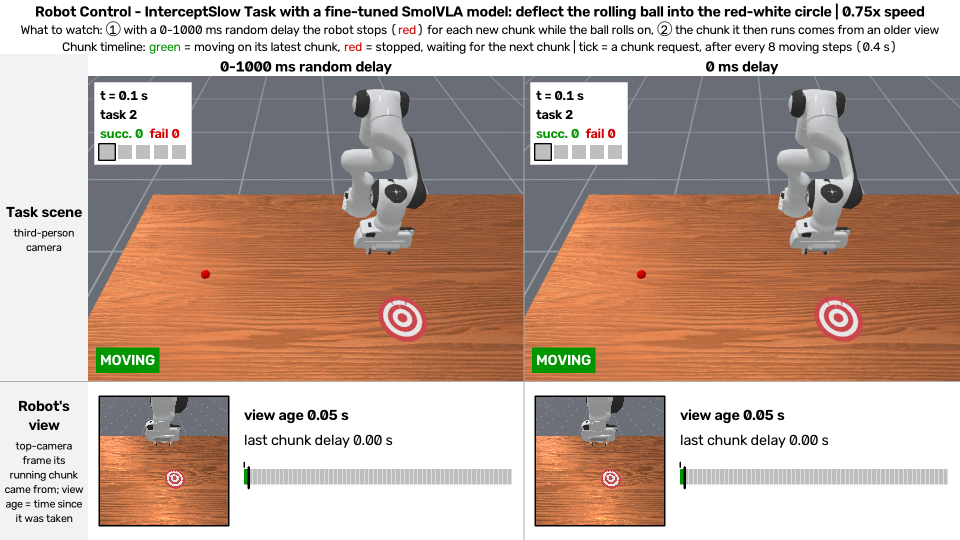
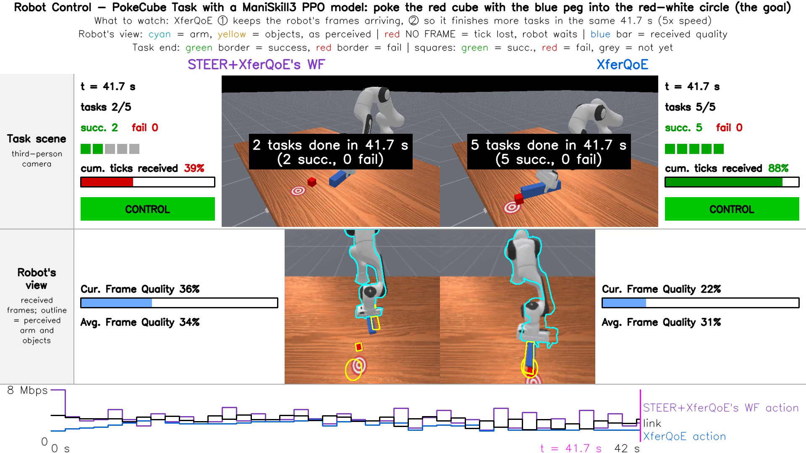
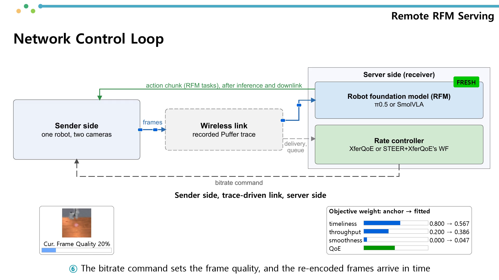
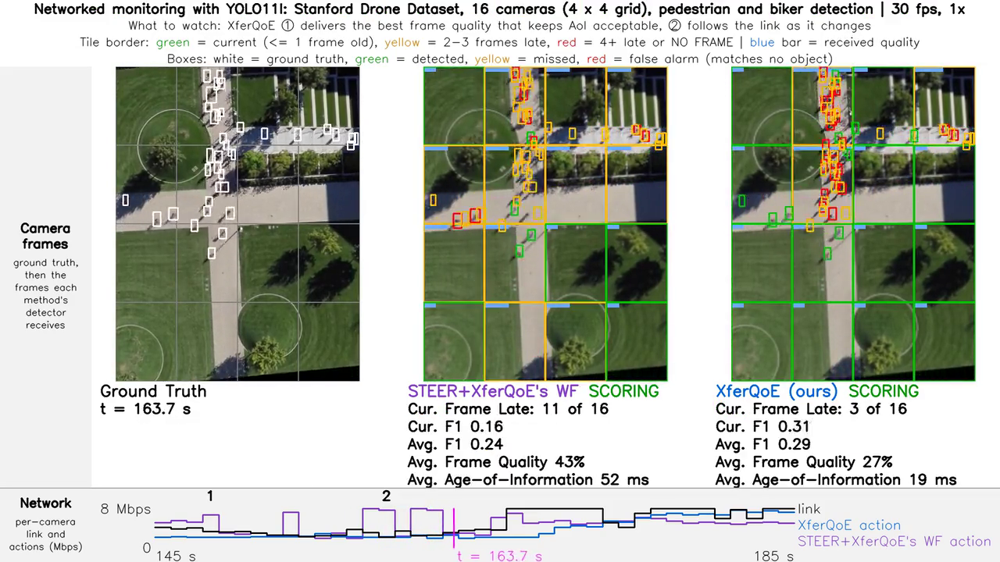

# Demo videos

Short demo videos: a robot policy under network delay, a robot controlled over a wireless link by two rate controllers, robot foundation models served over a wireless link, and sixteen cameras sharing one wireless link. Each picture opens a page that plays the video in the browser.

## 1. Moving-ball task under network delay: 0–1000 ms vs. 0 ms

[Play in the browser](https://sonny0714.github.io/demo_video_robot/moving-ball-delay.html) · [video file](videos/moving_ball_delay_0-1000ms_vs_0ms.mp4)

A fine-tuned SmolVLA policy intercepts a moving ball (MIKASA-Robo InterceptSlow, simulation). Both sides see the same 5 ball launches. 0.75× speed, 28 s.

- Left: every action-chunk request draws a uniform random delay of 0–1000 ms (none before a task's first chunk), and the robot waits for the new chunk before it moves (synchronous execution).
- Right: no delay.

In this clip the left side succeeds on 0 of the 5 launches and the right side on 4. Over all 200 evaluation episodes the success rates are 3.0% and 55.5%.

## 2. Rate control for robot manipulation: STEER+XferQoE's WF vs. XferQoE

[Play in the browser](https://sonny0714.github.io/demo_video_robot/xferqoe-pokecube.html) · [video file](videos/xferqoe_pokecube.mp4)

The edge server runs the robot policy (a frozen ManiSkill3 PokeCube policy) and the rate controller, and only the robot's observations cross the wireless link. Both runs replay the same bandwidth trace with the same policy and tasks, so only the rate controller differs. STEER+XferQoE's WF (STEER with XferQoE's objective-weight fit) plays first, then XferQoE over the same 41.7 s span. 5× speed, 28 s.

- STEER+XferQoE's WF: 2 tasks finished, a complete observation on 38.9% of the control ticks, mean frame quality 34.4%.
- XferQoE: 5 tasks finished, a complete observation on 88.1% of the control ticks, mean frame quality 30.7%.

## 3. Remote RFM serving: the control loop and two robot foundation model tasks

[Play in the browser](https://sonny0714.github.io/demo_video_robot/xferqoe-rfm-serving.html) · [video file](videos/xferqoe_rfm_serving.mp4)

The robot policy is a robot foundation model (RFM) on the edge server, π0.5 in a time-invariant task (LIBERO-Spatial) and SmolVLA in a time-varying one (MIKASA Intercept); it acts on the newest camera frame that arrives within its deadline, and the rate controller decides how the frames cross the wireless link. The video first animates this control loop on the system diagram, then plays the first five tasks of each on one bandwidth trace, STEER+XferQoE's WF first and XferQoE second, with the same model and scene, so only the rate controller differs. 1.5× and 0.7× speed, 2 min 42 s.

- LIBERO-Spatial with π0.5
	- By 36.9 s, when XferQoE has completed all five tasks, STEER+XferQoE's WF has finished two, with no success.
	- Fresh action chunks (frame at most one 50 ms step old): 42.2% for STEER+XferQoE's WF, 84.4% for XferQoE; mean frame quality 27.9% and 20.1%.
- MIKASA Intercept with SmolVLA
	- XferQoE succeeds in four of the five tasks, STEER+XferQoE's WF in none.
	- Views within 0.1 s (frame at most two 50 ms steps old): 37.1% for STEER+XferQoE's WF, 88.9% for XferQoE; fresh action chunks (at most one step old) 25.7% and 33.3%; mean frame quality 21.6% and 20.9%.

## 4. Networked monitoring: sixteen cameras on one wireless link

[Play in the browser](https://sonny0714.github.io/demo_video_robot/xferqoe-monitoring.html) · [video file](videos/xferqoe_monitoring.mp4)

Sixteen cameras share one wireless link to a server whose recognition model detects objects in their frames, and every interval is scored by detection F1 against the current ground truth. The video shows the ground truth, STEER+XferQoE's WF, and XferQoE on the same bandwidth trace from 145 to 185 s at 1× speed; the per-camera link opens at 167 s.

- At 148.5 s each camera's link is 3.3 Mbps: STEER+XferQoE's WF sends 6.7 Mbps, so camera 7 holds a frame three frames old and finds none of its five objects, while XferQoE sends 2.1 Mbps and finds four.
- Over the slow span (145–166 s) XferQoE's F1 is 0.286 against 0.235; after the link opens at 167 s, STEER+XferQoE's WF scores 0.769 against 0.721.
